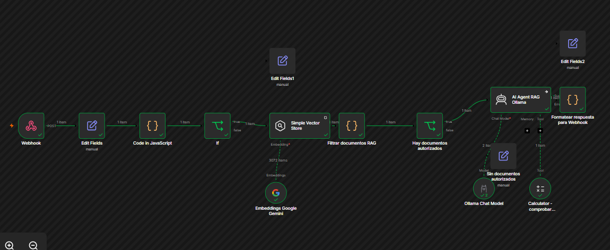
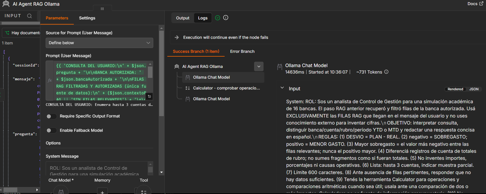

# Proyecto Final — Agente de consultas presupuestarias con RAG en n8n

**Curso:** AI Automation · **Comisión:** #97430  
**Autora:** Eliana Cardoso · **Fecha:** noviembre de 2026  
**Estado:** prototipo académico validado con datos sintéticos. Incluye dos workflows exportados: [`workflows/workflow-agente-rag.json`](workflows/workflow-agente-rag.json) (**V7 validada**) y [`workflows/workflow-ingesta-rag.json`](workflows/workflow-ingesta-rag.json) (ingesta limpia). La ingesta fue **reimportada y ejecutada correctamente** con 495 registros; el flujo de consulta **V7** respondió correctamente dos solicitudes simultáneas. El JSON público elimina referencias a credenciales e identificadores de instancia; después de importarlo se deben reasignar las credenciales. 

## 1. Caso de negocio

El proyecto surge de un proceso de Control de Gestión de una entidad financiera: análisis y comunicación mensual de desvíos presupuestarios para **16 bancas**. El flujo existente de Excel ya actualiza datos con **Power Query**, calcula presupuesto, real y desvíos con **Power Pivot/DAX** y presenta resultados mediante tablas dinámicas. La intervención manual restante consiste en identificar las partidas más importantes, interpretar variaciones y preparar comentarios para informar a cada banca.

El prototipo incorpora una **interfaz de consulta presupuestaria contextualizada**: ante una pregunta como «¿Cuál fue el desvío YTD de Sueldos básicos de la Banca 01?», recupera registros autorizados del conjunto ficticio y produce una respuesta con IA, sujeta a controles determinísticos. Es una **extensión del caso de análisis mensual**, no una automatización productiva del envío de los 16 correos; los borradores en Gmail correspondieron a una etapa de la Preentrega 3 y no forman parte de la versión de consulta V7.

Los datos que se utilizaron para las pruebas son totalmente ficticios. Ninguna conexión a bases del banco ni una integración real con WhatsApp están incluidas.

### ROI estimado: ahorro de tiempo y costo de implementación

Los valores de volumen y ahorro se basan en la **Preentrega 1**; los costos que se detallan debajo son **supuestos ilustrativos para presupuestar el proyecto**, no horas reales certificadas ni gastos ya incurridos.

| Concepto | Estimación |
|---|---:|
| Bancas previstas en el proceso | 16 |
| Tiempo manual actual | 30 min por banca = **8 h/mes** |
| Tiempo con automatización y revisión humana | **2 h/mes** |
| Tiempo bruto recuperado | **6 h/mes** |
| Ahorro relativo previsto | **75 %** |
| Equivalencia semanal | **1,38 h/semana** (4,33 semanas/mes) |
| Ahorro anual bruto potencial | **72 h/año** |

**Estimación de costos en horas equivalentes** (convertibles a pesos multiplicando por el costo interno de una hora de trabajo): se supone una inversión inicial de **16 h** de configuración y documentación, más **1 h/mes** para mantenimiento y recarga. Con estos supuestos, el primer año ofrece 72 h de beneficio bruto y 28 h de costos (16 + 12); el **beneficio neto ilustrativo es 44 h equivalentes** y el **ROI anual estimado = (72 − 28) / 28 × 100 = 157,1 %**. El punto de equilibrio sería aproximadamente **16 / (6 − 1) = 3,2 meses** después de la puesta en marcha.

Para una valuación monetaria verificable, sustituir las horas por el costo horario real y sumar infraestructura, energía, uso de APIs y mantenimiento. **No se midió todavía el ahorro real en producción.** Ollama no cobra por invocación local, pero utiliza hardware y energía; las llamadas a embeddings Gemini dependen de la cuota y condiciones de su API.

## 2. Por qué es un buen caso para RAG y un AI Agent

- El lenguaje de las preguntas es variable («mayor sobregasto», «cuenta», «rubro», «YTD/MTD»), mientras que las respuestas deben sustentarse en registros específicos y no en conocimiento general del modelo.
- **RAG** permite recuperar contexto que no está codificado en el modelo, con datos actualizables y metadatos de banca/rubro/período. Se limita el contexto a la banca autorizada antes de enviarlo al modelo.
- **AI Agent**, a diferencia de un nodo LLM simple, puede decidir utilizar una herramienta cuando la consulta lo requiere. En las pruebas previas del agente se observó una invocación de **Calculator** entre dos intervenciones de Ollama durante una comparación de cuentas. La herramienta **no es fuente de importes**: solo opera sobre cifras recuperadas. En esta implementación la recuperación RAG es **obligatoria y anterior al agente** para impedir que este omita la búsqueda.
- Una etapa determinística posterior coteja importe, signo, período y selección del mayor sobregasto. Esta verificación es necesaria porque en pruebas anteriores Ollama interpretó algunos signos de manera incorrecta.

## 3. Arquitectura técnica y dos entradas

```text
ENTRADA A — INDEXACIÓN (workflow complementario)
Formulario n8n (carga XLSX) → Extract From File (Datos_n8n)
→ Code (agrupar filas) → Filter (Banca 01 en la demo)
→ Loop Over Items → Default Data Loader + Embeddings Google Gemini
→ Simple Vector Store (Insert Documents, clave rag_banca_01)

ENTRADA B — CONSULTA (workflow V7)
Webhook POST → Edit Fields → Code (permisos simulados) → IF
  False → Edit Fields1 (rechazo)
  True  → Simple Vector Store (Get Many + Gemini embeddings)
        → Filtrar documentos RAG → IF (filas pertinentes)
             False → Sin documentos autorizados
             True  → AI Agent RAG Ollama + Calculator
                  → Formatear respuesta para Webhook (validación numérica)
                  Error → Edit Fields2 (contingencia)
```

Las **dos entradas** son distintos disparadores en **dos workflows complementarios**: el formulario recibe el dataset para indexación, y el Webhook recibe las preguntas. La consulta principal tiene un único Webhook. La consigna dice que pueden elegirse distintas fuentes; si la corrección docente interpreta “entradas múltiples” como *dos triggers en el mismo workflow*, ese criterio debe confirmarse o ajustarse antes de entregar.

### Componentes y elección técnica

| Componente | Decisión y justificación |
|---|---|
| Orquestador | **n8n** local en Docker, permite rutas explícitas y exportación JSON |
| Entrada de consultas | Webhook `POST` con `from` y `text.body`, similar a un mensaje de chat, sin conexión real con WhatsApp |
| Vector Store | **Simple Vector Store** de n8n, clave `rag_banca_01`, suficiente para una prueba local y compatible con el requisito de almacenamiento vectorial; **es volátil**, no persistente. Para operar de forma sostenida debe migrarse a Supabase/PGVector u otra base persistente, con autenticación y filtros de autorización por banca desde la consulta |
| Recuperación | `Get Many`, `topK=8`, búsqueda de documentos por pregunta; filtro posterior por metadatos y filas relevantes |
| Embeddings | **Google Gemini Embeddings** en la ingesta y en la consulta; arquitectura híbrida, no totalmente offline |
| Modelo generador | **Ollama `qwen2.5:3b`**, temperatura `0.1`: evita pagar por token de generación, requiere recursos del equipo y puede cometer errores |
| Agente y herramienta | `AI Agent RAG Ollama` + `Calculator - comprobar operaciones`; usa contexto recuperado previamente. **No utiliza Simple Memory**: el `sessionId` se recibe y conserva en el flujo, pero no se guarda historial conversacional entre solicitudes |
| Controles determinísticos | IF de autorización, IF de filas relevantes y Code final que valida valores, signos y formato |
| Salida | JSON vía Webhook con `output` y, según el caso, `estado`, `codigo`, `verificacion` |

### Convención de datos

La entrada XLSX contiene una hoja **`Datos_n8n`** con **495 filas sintéticas para 16 bancas**. Se conserva la jerarquía **BANCA → RUBRO → SUB_RUBRO → CUENTA/NOMBRE_CUENTA**, y los campos `PLAN_YTD`, `REAL_YTD`, `DESVIO_YTD`, `PLAN_MTD`, `REAL_MTD` y `DESVIO_MTD` (entre otros). **DESVIO = PLAN − REAL**; negativo significa **sobregasto** y positivo **menor gasto**. El agente no debe inventar causas ni presentar una muestra parcial como total de rubro.

En la prueba documentada, la ingesta agrupa las 495 filas en 64 combinaciones banca/rubro y carga las de Banca 01; las consultas end-to-end están validadas principalmente para esa banca. El alcance objetivo es 16 bancas, pero eso **no equivale a decir que las 16 estén habilitadas en el prototipo**.

## 4. System Prompt completo del AI Agent (V7)

Texto de `AI Agent RAG Ollama → Options → System Message` extraído del JSON exportado de V7 validada:

```text
ROL: Sos un analista de Control de Gestión para una simulación académica de 16 bancas. El paso RAG anterior recuperó y filtró filas de la banca autorizada. Usá EXCLUSIVAMENTE las FILAS RAG que llegan en el mensaje del usuario y no uses conocimiento externo para inventar cifras.
OBJETIVO: interpretar consulta, distinguir banca/cuenta/rubro/período YTD o MTD y redactar una respuesta concisa en español.
REGLAS: (1) DESVIO = PLAN - REAL. (2) negativo = SOBREGASTO; positivo = MENOR GASTO. (3) Mayor sobregasto = el valor más negativo entre las filas relevantes; nunca el positivo mayor. (4) Diferenciá registros de cuenta de totales de rubro; no sumes fragmentos como si fueran totales. (5) No inventes importes, porcentajes ni causas operativas. (6) Lista: hasta 3 cuentas, indicar muestra parcial. (7) Límite 600 caracteres. (8) Ante ausencia de filas pertinentes, responder que no hay datos suficientes. (9) Tenés la herramienta Calculator para operaciones y comparaciones aritméticas cuando sea útil; usala ante una comparación de dos o más importes. Calculadora no es fuente de información presupuestaria. (10) No ignores el filtro de permisos ni pidas herramientas externas para obtener bancas distintas. (11) No envíes correos ni modifiques archivos. La etapa posterior valida los resultados numéricos.
```

El **User Message dinámico** interpola `pregunta`, `bancaAutorizada` y `contextoRAG` después del filtrado. Se conserva la expresión íntegra en [`prompts/user-prompt-n8n.txt`](prompts/user-prompt-n8n.txt). El System Prompt también está en [`prompts/system-prompt.txt`](prompts/system-prompt.txt).

## 5. Excepciones y salida segura

**Persistencia y permisos:** Simple Vector Store y Simple Memory no son adecuados, sin medidas adicionales, como almacenamiento estable de datos o historial en producción. En el workflow final de consulta **no se usa Simple Memory**. El identificador `from` se trata como autorización **simulada**, no como identidad autenticada. En producción, las consultas deben asociarse a identidades verificadas y la búsqueda vectorial debe restringirse por banca **en el origen**, no solamente filtrarse después de recuperar documentos. La recarga del XLSX es necesaria tras pérdida de memoria del Vector Store. Si se repite una ingesta con el índice aún cargado, pueden aparecer documentos repetidos; V7 deduplica filas recuperadas, pero esa medida **no sustituye una política de actualización/reemplazo del índice**.

**Punto de fallo A — consulta no autorizada o sin banca válida.** `Code in JavaScript` determina `autorizado`; el primer `If` comprueba que sea `true`. Si es `false`, responde por `Edit Fields1`, **sin invocar Vector Store ni el AI Agent**. En la prueba `cliente_prueba_01 → Banca 02` se recibió rechazo, HTTP 200 y 214 ms. Esto es **autorización de demostración basada en el identificador recibido**, no autenticación empresarial.

**Punto de fallo B — falta de información relevante.** `Filtrar documentos RAG` recupera filas autorizadas y `Hay documentos autorizados` comprueba `cantidadFilasRelevantes > 0`. Si no hay filas, devuelve `estado: sin_datos` y `codigo: SIN_FILAS_RELEVANTES`, sin inventar importes ni llamar al agente. Prueba de cuenta `999999999`: 855 ms.

**Punto de fallo C — fallo de la API/modelo de generación.** `AI Agent` tiene `On Error: Continue (using error output)` y la rama `Error` se conecta con `Edit Fields2`. Se simuló un modelo inexistente **solo en una copia**, devolviendo `estado: error` y `codigo: SERVICIO_NO_DISPONIBLE`, con mensaje de contingencia. La V7 exportada conserva `qwen2.5:3b`; el modelo inexistente solamente se usó en una copia descartada.

**Alcance del control:** no se hizo una inyección deliberada de timeout del **Vector Store** ni una prueba aislada de salida nula del LLM. No corresponde afirmar que esos escenarios estén específicamente cubiertos. Pueden añadirse rutas de error/timeout propias si el criterio docente exige todas las fallas enumeradas, no solamente dos puntos de control.

**HTTP 200** indica que el transporte HTTP entregó un JSON; los fallos de negocio pueden estar expresados en `estado` y `codigo`. No equivale necesariamente a autorización o éxito funcional.

## 6. Evidencias de ejecución y prueba de concurrencia (V7 + antecedentes V6)

Todas las capturas se obtuvieron con datos ficticios en n8n local y PowerShell. Las capturas **02–10 corresponden a pruebas históricas de V6**, útiles para evidenciar decisiones del agente, controles y contingencia; las **11–13 documentan ingesta limpia y V7**. Las capturas no equivalen a una única ejecución correlacionada si corresponden a pruebas distintas.

| Evidencia | Resultado | Imagen |
|---|---|---|
| Ingesta desde formulario | 495 filas; agrupamiento y carga vectorial | [Captura 1](capturas/01-ingesta-excel-vector-store.png) |
| Canvas histórico de consulta V6 ejecutado | RAG → AI Agent → validación final | [Captura 2](capturas/02-v6-canvas-ejecucion-exitosa.png) |
| Consulta individual YTD | −39.080 (sobregasto), HTTP 200; **42.604 ms** | [Captura 3](capturas/03-consulta-individual-powershell.png) |
| Comparación de 3 cuentas | Plus vacacional: mayor sobregasto de la muestra, **36.302 ms** | [Captura 4](capturas/04-comparacion-powershell.png) |
| Logs AI Agent | Modelo → Calculator → Modelo | [Captura 5](capturas/05-ai-agent-calculator-logs.png) |
| Cuenta inexistente | `sin_datos`, 855 ms | [Captura 6](capturas/06-cuenta-inexistente.png) |
| Consulta de otra banca | Rechazo, 214 ms | [Captura 7](capturas/07-rechazo-banca-02.png) |
| IF de permisos | `autorizado=false` → False Branch | [Captura 8](capturas/08-if-autorizacion-false.png) |
| Falla simulada de Ollama | `SERVICIO_NO_DISPONIBLE` | [Captura 9](capturas/09-contingencia-ollama-powershell.png) |
| Rama de contingencia | Agent → Edit Fields2 | [Captura 10](capturas/10-contingencia-ollama-workflow.png) |
| Ingesta limpia reimportada | Formulario, 495 filas, 64 grupos, 4 grupos de Banca 01 e inserción comprobada | [Captura 11](capturas/11-ingesta-limpia-validada.png) |
| V7, cuenta individual | Plus vacacional: −55.610, `ok`, `cuenta_validada` | [Captura 12](capturas/12-v7-consulta-individual.png) |
| V7, dos consultas simultáneas | Sueldos básicos 28,24 s y Plus vacacional 41,88 s; ambas correctas | [Captura 13](capturas/13-v7-prueba-concurrencia.png) |
| V6, causa del fallo previo | Filas de Plus vacacional devueltas duplicadas, antes de deduplicación V7 | [Captura 14](capturas/14-v6-duplicados-diagnostico.png) |
| Recursos (captura de prueba V6 anterior) | CPU 35 %, RAM 74 %, disco 13 % — **no corresponde a la prueba V7** | [Captura 15](capturas/15-recursos-referencia.png) |





### Prueba de concurrencia sobre V7 (18/11/2026)

Se enviaron **dos solicitudes simultáneas** a la URL de producción `/webhook/consulta-presupuesto-rag-ai-agent-v7`. Ambas obtuvieron `HTTP 200`, `estado=ok` y `verificacion=cuenta_validada`:

| Pregunta | Resultado validado | Tiempo extremo a extremo |
|---|---|---:|
| Sueldos básicos, Banca 01, YTD | **−39.080** (sobregasto) | **28,24 s** |
| Plus vacacional, Banca 01, YTD | **−55.610** (sobregasto) | **41,88 s** |

**Tasa de éxito observada:** 2/2 (100 %); **errores observados:** 0/2; **latencia promedio de las dos:** 35,06 s. Esta es una **muestra exploratoria de tamaño 2**, no una garantía de escalabilidad, tiempo de respuesta bajo carga real, p95 ni rendimiento multiusuario. Durante una prueba anterior de concurrencia sobre V6 se fotografió el Administrador de tareas con **CPU 35 %, RAM 74 % y disco 13 %**; es una **instantánea del equipo completo de otra ejecución**, no un dato de consumo del test V7 ni un pico de Ollama. Ver [registro detallado](docs/PRUEBAS.md) y [prueba de carga](docs/PRUEBA_CARGA_V7.md).

Se observó un error HTTP 404 en un intento previo que no se contabiliza como fallo de IA: se debía a usar el endpoint de prueba. Al utilizar la ruta de producción las dos consultas completaron correctamente. Antes, V6 había recuperado **dos copias de una misma fila** y su validador marcaba ambigüedad. La V7 deduplica por banca/rubro/cuenta/contenido y en el validador final, conservando filas distintas. Esto se documenta en [cambios V7](docs/CAMBIOS_V7.md).

Las pruebas históricas de V6 conservan valor para mostrar controles del agente, pero las evidencias de **concurrencia y deduplicación pertenecen a V7**. Las respuestas financieras finales pueden ser corregidas por el Code: no debe atribuirse al agente una exactitud que no demostró por sí mismo. El guion usado está disponible en [`scripts/prueba-carga-2-consultas.ps1`](scripts/prueba-carga-2-consultas.ps1).

## 7. Reproducir localmente

1. Instalar y ejecutar n8n y Ollama; descargar `qwen2.5:3b` con `ollama pull qwen2.5:3b`.
2. Obtener credenciales válidas de Gemini Embeddings en n8n. El nombre del modelo de embeddings debe ser compatible entre indexación y recuperación.
3. Importar los **dos JSON** en `workflows/`: primero **ingesta RAG** (`workflow-ingesta-rag.json`), luego **consulta AI Agent V7** (`workflow-agente-rag.json`). Restablecer credenciales necesarias sin publicar API keys, tokens ni secretos.
4. En la ingesta, cargar el XLSX sintético con la hoja `Datos_n8n`. Verificar la inserción en Simple Vector Store **`rag_banca_01`**. La clave debe coincidir en el flujo de consulta y ejecutarse en la misma instancia de n8n.
5. En la consulta, abrir el nodo Webhook y ejecutar `Listen for test event`. Copiar la **Test URL exacta**.
6. Probar con PowerShell: `./scripts/probar-webhook.ps1 -Url 'http://localhost:5678/webhook-test/RUTA-REAL' -Caso individual`. Para otros casos utilizar `-Caso comparacion`, `sin_datos` o `no_autorizado`.
7. Abrir la ejecución y contrastar **Logs** del agente, respuestas `output`, `estado`, `verificacion` y ramas de contingencia.

**Atención:** Simple Vector Store guarda la información en memoria. Si n8n se reinicia, los datos pueden desaparecer: es preciso **volver a ejecutar la ingesta**. El ZIP no incluye el XLSX original porque no estuvo disponible como archivo de origen verificable para este armado; usar solo datos sintéticos.

### Ejemplo de entrada y salida

Solicitud de ejemplo:

```json
{
  "from": "cliente_prueba_01",
  "text": { "body": "¿Cuál fue el desvío YTD de Sueldos básicos de la Banca 01?" }
}
```

Salida observada:

```json
{
  "output": "Banca 01 – Sueldos básicos: desvío YTD de −39.080 (sobregasto).",
  "estado": "ok",
  "verificacion": "cuenta_validada"
}
```

## 8. Riesgos, limitaciones y continuidad

**Lo que ya se implementó:** entrada HTTP de consultas, ingesta por formulario en workflow complementario, búsqueda vectorial, embeddings, agente con herramienta, controles de permisos simulados, ausencia de datos, contingencia de modelo y verificación numérica posterior.

**Mejoras futuras, no alegadas como implementadas:** persistencia vectorial (Supabase/PGVector u otra), autenticación corporativa y permisos verificados en origen, integración real con WhatsApp, monitoreo de latencia/uso/tokens a escala, ingesta y consultas completas para las 16 bancas y eventual automatización del envío de informes con revisión humana. Para producción también sería necesario filtrar por banca **antes** de recuperar información del almacenamiento y no depender solamente del filtro posterior.

Los controles concretos ejecutados y el detalle de requisitos se documentan en [`docs/REQUISITOS_ENTREGA.md`](docs/REQUISITOS_ENTREGA.md). Antes de presentar, **reimportado y ejecutado** el JSON limpio de ingesta (sus nodos funcionales se conservaron sin cambios), reconectar credenciales y verificar la legibilidad de las capturas. La pequeña prueba de carga **ya se realizó sobre V7**, con dos solicitudes concurrentes y 2/2 respuestas correctas. No se deben presentar estos resultados como prueba de escalabilidad productiva.

